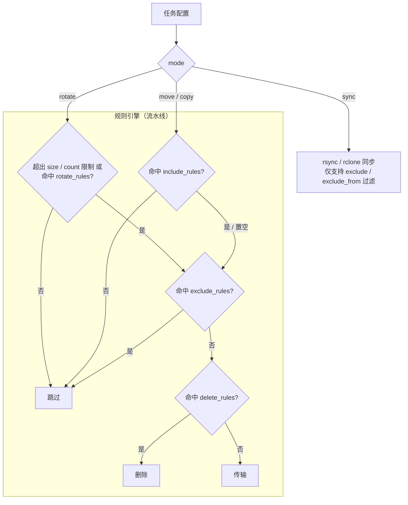

# SmartArchiver

SmartArchiver 是一个灵活的文件归档与清理工具，帮助你按规则自动管理磁盘上的文件——将旧文件移动到归档目录、清理过期日志、按条件轮转文件、或保持两个目录的镜像同步。

📝 [更新日志](./CHANGELOG.md) | 📋 [TODO 看板](./ROADMAP.md)

---

## 适用场景

SmartArchiver 解决的核心问题是：**“磁盘上有一堆文件，我想根据名字、大小、时间等条件，把它们搬运、删除或同步到别处”**。它既可作为一次性脚本，也可作为常驻服务定时运行。以下是几个典型场景：

- **冷热数据分层**：将 SSD 上超过 N 天未修改的文件自动迁移到 HDD 大容量存储，同时保留最近文件在高速盘上。
- **日志归档与清理**：将 `logs/` 目录下超过一定天数的大日志文件移动到归档目录；或当日志总体积超过阈值时，从最旧的开始轮转删除。
- **备份目录瘦身**：在备份目录中保留最近 N 份全量备份或限制总大小，超出部分自动清除。
- **选择性同步**：将源目录镜像同步到目标，但排除临时文件、缓存目录等不需要同步的内容。
- **白名单模式**：仅处理符合特定命名规则的文件（如只搬运 `*.mp4`），其他一律不动。
- **定时自动运行**：通过 cron 表达式或固定间隔，让程序在后台持续执行上述任务。
- **跨主机远程操作**：将文件归档到另一台主机（HTTP 远端），或通过 SSH 将目录镜像同步到远端服务器。

---

## 安装与部署

### 本地运行（客户端）

需要 Python 3.14+。

```bash
# 1. 克隆项目
git clone https://github.com/hexstan/smartarchiver.git
cd smartarchiver

# 2. 安装依赖（需 pip ≥ 25.1，Python 3.14 自带的 pip 已满足）
pip install --group runtime

# 3. 创建并编辑配置文件
cp config/config.example.toml config/config.toml
# 按需编辑 config/config.toml，各项含义与取值范围见下方「配置向导」

# 4. 一次性运行（客户端模式）
python main.py
```

如需使用同步（sync）模式：
- **Linux**：需安装 `rsync`（`apt install rsync` / `yum install rsync`）
- **Windows**：需安装 [`rclone`](https://rclone.org/downloads/) 并将其加入 PATH
- 可通过 `tool` 配置项强制指定工具（`"rsync"` 或 `"rclone"`）

### 运行子命令（后台运行 / 日志 / 停止 / 立即执行）

除直接前台运行外，还提供四个子命令；除 `run-once` 外均可与 `--server` 组合（如 `python main.py --server stop`），打包版同理（`SmartArchiver.exe start`）。

```bash
python main.py start          # 脱离终端运行，随后在本窗口滚动显示日志（窗口可随时关闭）
python main.py log [-n 100]   # 滚动显示运行日志（底部状态栏显示实例状态；-n 自定义初始行数，默认 100）
python main.py stop           # 停止运行中的实例
python main.py run-once       # 让休眠中的实例立即执行一轮任务，并滚动显示日志
```

- **start**：以后台实例方式启动并自动跟随日志。没有配置 `[schedule]`（一次性运行）同样可用；关闭终端或 Ctrl+C 退出日志跟随都不影响实例本身。若已有实例在运行则拒绝重复启动。
- **log**：滚动显示运行日志，自动跟随跨天轮转产生的新日志文件。窗口最后一行常驻反色状态栏，显示实例是否在运行（含 PID）；没有实例、实例中途退出都不结束跟随，只有 Ctrl+C 能结束。管道/重定向等非交互终端会自动省略状态栏。
- **stop** 的三种模式：
  - `stop`：当前文件传输完成后停止；
  - `stop --slow`：本轮任务全部结束后停止；
  - `stop --fast`：立即中止当前文件传输并退出，已写入的临时文件会被清理；5 秒内未退出则强制结束。sync 模式下会连同外部工具（rsync / rclone）及其子进程一并终止，不留孤儿进程。

  server 模式的 `stop` 不接受参数，行为固定为中止传输并尽快停止。实例空闲（等待下次调度）时收到任何 stop 都会立即退出。
- **run-once**：仅限客户端实例。要求实例已启动且正处于调度休眠期（等待下次运行，含 `first_run_delay` 等待期），满足时立即执行一轮任务，之后的下次运行时间按执行后的时刻重新计算；实例不存在或不在休眠期则报错退出。指令成功送达后进入日志跟随（同 start）。极小概率下指令恰好在实例从休眠转入执行的瞬间送达，此时实例忽略该指令并在 run-once 终端给出提示；server 模式没有调度循环，不支持此子命令。

### 打包版可执行文件（Windows / macOS）

不想配置 Python 环境可以直接使用打包版：**内置 rclone，sync 模式开箱即用**。

1. 从 [Releases](https://github.com/HexStan/SmartArchiver/releases) 下载对应平台的压缩包并解压：

   | 平台 | 文件 |
   | --- | --- |
   | Windows (AMD64) | `SmartArchiver-<版本>-windows-amd64.zip` |
   | Windows (ARM64) | `SmartArchiver-<版本>-windows-arm64.zip` |
   | macOS (Intel) | `SmartArchiver-<版本>-macos-amd64.zip` |
   | macOS (Apple Silicon) | `SmartArchiver-<版本>-macos-arm64.zip` |

2. 解压后得到 `SmartArchiver` 目录，入口为：
   - **Windows**：`SmartArchiver.exe`
   - **macOS**：`SmartArchiver`（无后缀裸二进制）
3. 压缩包内的 `SmartArchiver/config/` 已附带示例配置：将 `config.example.toml` 复制（或重命名）为 `config.toml` 并编辑即可运行；服务器模式同理使用 `config.server.example.toml`。

> macOS 提示：首次运行若提示“无法验证开发者”，先执行 `xattr -dr com.apple.quarantine SmartArchiver` 清除隔离属性。

说明：
- 配置文件、日志等均位于可执行文件同级目录（`config/`、`logs/`），不写入系统目录。
- 打包版运行 `--server` 参数同样支持服务器模式（需配置 `config/config.server.toml`）。
- 开发版（`pyproject.toml` 的 version 带 `-dev` 后缀）的构建产物不发布到 Release，可在 GitHub Actions 对应 run 的 **Artifacts** 中下载。
- 自行构建：`pip install --group build && python scripts/build_executable.py`。

### 服务器模式（HTTP Server）

SmartArchiver 可作为 HTTP 服务器运行，接受来自其他客户端实例的远程文件操作请求。

```bash
# 1. 创建服务器配置文件
cp config/config.server.example.toml config/config.server.toml
# 编辑 api_key（API 认证密钥）、port（监听端口）等参数

# 2. 启动服务器
python main.py --server        # 前台运行
python main.py --server start  # 脱离终端运行并跟随日志
python main.py --server stop   # 停止（中止进行中的传输并尽快退出）
```

服务器提供两个 API 端点：`POST /api/remote`（元数据操作）和 `POST /api/remote/upload`（文件上传），支持并发控制和排队机制。配置参数详见[配置向导·第三步·HTTP 服务器配置](#http-服务器配置)。

### Docker 部署（推荐）

项目为三种角色提供了独立的镜像：**客户端**、**HTTP 服务器**和 **SSH 远端服务器**。

#### 客户端 / HTTP 服务器镜像

应用镜像基于 `python:3.14-slim-trixie`，已内置 `rsync`。GitHub Actions 自动构建 `linux/amd64` 和 `linux/arm64` 多架构镜像，发布到 `ghcr.io/hexstan/smartarchiver`。

```bash
# 1. 创建并编辑配置文件
cp config/config.example.toml config/config.toml

# 2. 按需编辑 docker-compose.yml 中的目录挂载映射

# 3. 启动客户端容器
docker-compose up -d

# 查看日志
docker-compose logs -f
```

`docker-compose.yml` 中预置了三种服务，按需取消注释即可启用：
- **client**（默认启用）：运行客户端任务
- **server**（已注释）：运行 HTTP 服务器，需配合 `command: ["--server"]` 和 `config.server.toml`
- **ssh-server**（已注释）：SSH 远端目标，供 sync 模式使用

`docker stop` 会向容器发送 SIGTERM，程序将其按 `stop --fast` 处理：立即中止文件传输、清理临时文件并退出。默认 10 秒宽限期通常足够；如担心极端情况，可在 compose 服务中加 `stop_grace_period: 30s` 留出余量。

也可直接构建镜像（注意 Dockerfile 路径）：

```bash
docker build -f docker/app/Dockerfile -t smart-archiver .
docker run -d \
  --name smart-archiver \
  --restart unless-stopped \
  -v $(pwd)/config:/app/config \
  -v $(pwd)/logs:/app/logs \
  -v /your/source:/app/source \
  -v /your/dest:/app/dest \
  smart-archiver
```

#### SSH 远端服务器镜像

为 sync 模式提供开箱即用的 SSH 远端目标容器（Alpine + OpenSSH + rsync），镜像发布到 `ghcr.io/hexstan/sa-ssh-server`。内置 rsync 且启用 SFTP 子系统，客户端无论走 rsync-over-SSH 还是 rclone SFTP 都可直接对接。

镜像的部署（密钥对生成、容器启动、密码认证备选、参数说明）与客户端的连接配置、连通性验证，统一见[配置向导·第三步·SSH 服务器配置](#ssh-服务器配置)。项目仓库自带的 `docker-compose.yml` 也预置了此服务（密码认证版），单机同仓库部署时取消注释即可使用。

---

## 配置向导

本章以**分步**的方式引导你完成配置文件的编写：先完成全局设置与定时调度，需要远程目标时先把远端配置好并验证连通，再定义任务——明确目标、填写参数、按需叠加规则。

---

### 第一步：全局设置

```toml
instance_name = "smartarchiver"           # 实例标识名：锁文件/控制文件/日志文件共用此名
log_dir = "./logs"                        # 日志目录
log_level = "INFO"                        # 日志级别：DEBUG / INFO / SUCCESS / WARNING / ERROR / CRITICAL
max_log_files = 30                        # 保留的日志文件数量，0 表示不清理
```

**关于实例标识**：`instance_name` 只填名称（不带任何后缀），锁文件（`<标识>.lock`）、控制文件（`<标识>.ctl`）、PID 文件（`<标识>.pid`）统一存放在系统临时目录（Linux 的 `/tmp`、macOS 的用户临时目录、Windows 的 `%TEMP%`），具体位置由程序按平台决定；日志文件名亦以该标识为前缀（`<标识>.YYYY-MM-DD.log`）。未填或非法时使用默认标识——客户端为 `smartarchiver`，服务器模式为 `smartarchiver-server`。需要同时运行多个实例时，为每份程序配置不同的 `instance_name` 即可；Docker 容器各自拥有独立的临时目录，互不影响。

> 服务器模式同样读取本节各项（写入 `config/config.server.toml`），服务器专属参数见[第三步·HTTP 服务器配置](#http-服务器配置)。

---

### 第二步：配置定时调度（可选）

如果不配置 `[schedule]` 块，程序将作为一次性脚本运行（执行完所有任务后退出）。要让它常驻运行，添加：

```toml
[schedule]
mode = "interval"            # "cron" 或 "interval"
interval_seconds = 3600      # interval 模式：每次执行完等待的秒数
# cron_expr = "0 * * * *"   # cron 模式：cron 表达式
# first_run_delay = -1      # 启动后首次执行延迟（秒）；-1=等到下个调度点，0=立即，正数=等N秒
```

**两种定时模式**：
- `interval`：每次任务执行完毕后开始计时，等待指定秒数后再次执行
- `cron`：按 cron 表达式定时执行（如 `"0 2 * * *"` 表示每天凌晨 2 点）

**校验规则**：`cron` 模式必须配置 `cron_expr`；`interval` 模式必须配置大于 0 的 `interval_seconds`，否则配置校验失败。

**`first_run_delay`** 控制启动后首次执行的延迟（秒），仅在配置了 `mode` 时生效：
- `-1`：等待至下个调度时间点再执行（默认）
- `0`：立即执行
- 正数：等待指定秒数后执行第一次任务

程序支持配置热重载：在 `interval` 或 `cron` 定时运行期间，修改 `config.toml` 后程序会在下次执行前自动加载新配置。如新配置验证失败，会自动回退到备份配置。

---

### 第三步：配置远程目标（可选）

如果 `dest` 不是本地路径，你需要配置远程目标后端。SmartArchiver 支持三种后端：

| 后端 | dest 格式 | 支持的模式 | 说明 |
|------|----------|-----------|------|
| 本地 | `"./local/path"` | 全部 | 默认，无需额外配置 |
| HTTP 远端 | `"{http:别名}?路径"` | move / copy / rotate | 远端需运行 SmartArchiver 服务器 |
| SSH 远端 | `"{ssh:别名}?路径"` | 仅 sync | 远端需安装 rsync 或启用 SFTP |

HTTP 和 SSH 的别名命名空间完全隔离，同一别名可同时用于两者。

#### HTTP 服务器配置

HTTP 远端的本质是把文件操作请求发给另一台 SmartArchiver **服务器实例**，因此先在远端主机上配置并启动服务器模式。服务器配置文件为 `config/config.server.toml`（由 `cp config/config.server.example.toml config/config.server.toml` 生成）：

```toml
api_key = "your_api_key"        # 客户端连接鉴权密钥
port = 13579                    # HTTP 服务监听端口
max_concurrent_metadata = 1     # 最多同时处理的元数据请求数量
max_queue_metadata = 32         # 元数据请求的排队上限
max_concurrent_uploads = 1      # 最多同时处理的上传请求数量
max_queue_uploads = 32          # 上传请求的排队上限
```

| 参数 | 默认值 | 允许范围 | 说明 |
|------|--------|----------|------|
| `api_key` | `""` | 非空字符串 | 客户端连接时使用的 API 鉴权密钥；留空等于无鉴权，务必设置 |
| `port` | `13579` | 1–65535 | HTTP 服务监听端口 |
| `max_concurrent_metadata` | `1` | ≥ 1 | 最多同时处理的元数据请求数量 |
| `max_queue_metadata` | `32` | ≥ 0 | 元数据请求的排队上限 |
| `max_concurrent_uploads` | `1` | ≥ 1 | 最多同时处理的上传请求数量 |
| `max_queue_uploads` | `32` | ≥ 0 | 上传请求的排队上限 |

服务器提供两个 API 端点：`POST /api/remote`（元数据操作）和 `POST /api/remote/upload`（文件上传）。客户端排队等待的时长由客户端侧的 `queue_time` 决定；队列已满或等待超时，服务器会向客户端返回 503。启动与后台运行方式见[服务器模式](#服务器模式http-server)。

#### 连接 HTTP 目标

在 `config.toml` 中配置 `[[http_remotes]]`（`alias` 仅允许 a-z、A-Z、0-9、-、_），然后在任务的 `dest` 中引用：

```toml
[[http_remotes]]
alias = "my_nas"
address = "http://192.168.10.10:13579"   # 也可填反向代理后的 HTTPS 域名，如 "https://sa.bob.com"
key = "your_api_key"
timeout = 14400       # 请求超时（秒），默认 4 小时
queue_time = 120      # 服务器繁忙时排队秒数，0 表示不排队直接放弃
```

远端需运行 `python main.py --server`（详见[服务器模式](#服务器模式http-server)）。

`dest` 的写法为 `{http:别名}?远端路径`：

```toml
dest = "{http:my_nas}?/vol/1000/backup"
dest = "{http:my_pc}?D:/Backup"   # 远端为 Windows 主机时填其盘符路径
```

#### SSH 服务器配置

没有现成的 SSH 服务器？可用官方 [SSH 远端服务器镜像](#ssh-远端服务器镜像)（Alpine + OpenSSH + rsync，内置 SFTP 子系统）在远端主机上部署一个。

> 本节默认典型部署：**SmartArchiver（客户端）与 SSH 服务器分属两台主机**，服务器端以 Docker Compose 部署。两台主机为同一台时流程相同，可省去第 2 步中复制公钥的操作。

SSH 公钥认证的原理：**私钥只留在客户端，公钥登记到服务端**。连接时，服务端 sshd 用自己 `authorized_keys` 里登记的公钥验证客户端确实持有配对的私钥——私钥全程不出机，公钥本身是公开信息、可随意复制。

**第 1 步：在客户端生成密钥对**

在 **SmartArchiver 所在主机（客户端）**的 `docker-compose.yml` 同级目录中生成密钥对（客户端以 Docker 部署时的默认密钥位置）：

```bash
mkdir -p ./ssh && ssh-keygen -t ed25519 -f ./ssh/id_ed25519 -N ""
```

**第 2 步：在服务器主机部署容器**

把客户端 `./ssh/id_ed25519.pub` 的**文件内容**复制到服务器主机（scp、手动粘贴均可），保存为 `./ssh/authorized_keys` 文件——容器会把它挂载为 root 用户的 `/root/.ssh/authorized_keys`，即 sshd 校验公钥的位置。多个公钥每行一条。

> ⚠️ 先创建文件再启动容器：若挂载源不存在，Docker 会自动创建同名**目录**而非文件，公钥认证会因此失效。

创建 `docker-compose.yml` 并启动：

```yaml
services:
  ssh-server:
    image: ghcr.io/hexstan/sa-ssh-server:latest
    container_name: sa-ssh-server
    restart: unless-stopped
    ports:
      - "2222:22"
    volumes:
      - /path/to/data:/data
      - ./ssh/authorized_keys:/root/.ssh/authorized_keys
    # environment:
    #   - ROOT_PASSWORD=your_password   # 密码认证备选，见下文
```

```bash
docker compose up -d
```

此方式未设置 `ROOT_PASSWORD`，root 无密码、密码登录自然失效，只能通过私钥连接。

**密码认证（备选）**：内网等可信环境想省去密钥步骤时，取消注释 `environment` 段设置 `ROOT_PASSWORD`（公钥挂载可保留，两种认证可并存）；或直接使用最简 docker run：

```bash
# 在服务器主机上运行
docker run -d \
  --name sa-ssh-server \
  --restart unless-stopped \
  -p 2222:22 \
  -e ROOT_PASSWORD=your_password \
  -v /path/to/data:/data \
  ghcr.io/hexstan/sa-ssh-server:latest
```

**不使用 Docker Compose？** 公钥认证的等效 docker run（公钥文件已在服务器主机上）：

```bash
docker run -d \
  --name sa-ssh-server \
  --restart unless-stopped \
  -p 2222:22 \
  -e AUTHORIZED_KEYS="$(cat ./ssh/authorized_keys)" \
  -v /path/to/data:/data \
  ghcr.io/hexstan/sa-ssh-server:latest
```

**参数说明**：

| 参数 | 说明 |
|------|------|
| `-p 2222:22` | 服务器主机端口映射到容器内 22。客户端 `port` 必须填**映射后的主机端口**（本例 `2222`），而非 22 |
| `-v /path/to/data:/data` | 数据目录挂载。客户端 `dest` 必须填**容器内路径**（本例 `/data` 或其子路径） |
| `ROOT_PASSWORD` | 设置 root 用户密码，启用密码认证 |
| `AUTHORIZED_KEYS` | 写入 root 用户公钥（换行分隔多个），启用公钥认证；与挂载 `authorized_keys` 文件二选一 |

两种认证方式可同时启用。容器启动时会自动生成缺失的 SSH 主机密钥；重建容器会更换主机密钥，SmartArchiver 客户端连接时禁用了主机密钥校验，不会因此连接失败。

**验证连接**：容器启动后，回到 **SmartArchiver 所在主机（客户端）**，手动测试到服务器主机的 SSH 连通性：

```bash
# 公钥认证（指定第 1 步生成的私钥）
ssh -i ./ssh/id_ed25519 -p 2222 root@服务器IP

# 密码认证
ssh -p 2222 root@服务器IP
```

能登录且能看到目标目录（如 `/data`）后，即可按下一节配置客户端开始同步。

#### 连接 SSH 目标

仅 sync 模式支持。在 `config.toml` 中配置 `[[ssh_remotes]]`（`alias` 仅允许 a-z、A-Z、0-9、-、_，与 HTTP 远端的命名空间隔离，允许重名），再在任务的 `dest` 中以 `{ssh:别名}?路径` 引用（路径为远端 POSIX 绝对路径）：

```toml
[[ssh_remotes]]
alias = "my_vps"                           # 必填
host = "192.168.1.100"                     # 必填，SSH 服务器地址
user = "root"                              # 必填，SSH 用户名
port = 2222                                # 选填，默认 22；使用 sa-ssh-server 镜像（-p 2222:22）时填 2222
key_file = "/root/.ssh/id_ed25519"         # 选填，私钥路径（公钥认证）；示例为 Docker 客户端的容器内路径，见下方说明
password_file = "/root/.ssh/pass"          # 选填，明文密码文件路径（密码认证，内容为单行密码），见下方说明

[[tasks]]
mode = "sync"
source = "./data"
dest = "{ssh:my_vps}?/data"                # 同步到远端 /data 目录
```

**认证方式**（两者都未配置时回退 SSH 默认行为：`~/.ssh/id_rsa` 等默认密钥或 ssh-agent）：

| 方式 | 配置 | 客户端依赖 |
|------|------|-----------|
| 公钥认证 | `key_file` 指向私钥，对应公钥需在远端的 `authorized_keys` 中 | 无额外依赖 |
| 密码认证 | `password_file` 指向仅含一行密码的文本文件 | rsync 通道需安装 `sshpass`；rclone 通道无额外依赖 |

底层通过 `rsync -e "ssh ..."` 或 `rclone :sftp:` 实现，密码传递方式随通道不同：

- **rsync 通道**（Docker 应用镜像、未装 rclone 的 Linux/macOS）：密码经 `sshpass -f` 传递，客户端必须已安装 sshpass（Docker 应用镜像已内置）
- **rclone 通道**（打包版内置 rclone、Windows、`tool = "rclone"`）：走 SFTP，密码经环境变量传给 rclone，不依赖 sshpass

**安全提示**：
- 客户端连接禁用了主机密钥校验（`StrictHostKeyChecking=no`），首次连接无需确认指纹，请确保网络环境可信
- `password_file` 为明文，建议设置权限（如 `chmod 600`）并避免提交到版本库；公网环境优先使用公钥认证
- 客户端跑在 Docker 中时，取消注释 client 服务中的 `./ssh/id_ed25519:/root/.ssh/id_ed25519`（密码认证再加 `./ssh/pass:/root/.ssh/pass`），`key_file` / `password_file` 填容器内路径——即上方示例；非 Docker 客户端直接填私钥与密码文件的宿主机路径
- 挂载源文件必须已存在（否则 Docker 会创建同名**目录**，容器内拿到的是空目录），与服务器端 `authorized_keys` 的注意事项相同

---

### 第四步：明确任务目标

SmartArchiver 的核心能力是**对源目录中的文件执行某种操作**。根据你想做的事，选择对应的任务模式（`mode`）：

| 我想做什么 | 应选模式 | 关键词 |
|-----------|---------|--------|
| 把文件批量搬运到另一个目录 | `move` | 移动、归档、冷热分层 |
| 把文件批量复制到另一个目录 | `copy` | 复制、备份、多副本 |
| 限制目录体积/数量，超出部分自动清理 | `rotate` | 轮转、限额、清理 |
| 让两个目录保持完全一致（镜像同步） | `sync` | 同步、镜像、rsync |

**决策要点**：

- 如果目标是**“目录不能超过某个大小”**而非“移动具体哪个文件” → 选 `rotate`
- 如果源和目标需要**时刻保持一致**，且不关心单文件粒度规则 → 选 `sync`
- 其余常规归档/备份需求 → 选 `move` 或 `copy`

---

### 第五步：填写任务参数

确定模式后，按所选模式对应的表格填写参数。`✓` 表示必填，`○` 表示选填；每张表只列出该模式支持的参数，规则参数的完整语法与决策流程见[第六步](#第六步用规则精确筛选move--copy--rotate-模式)。

#### 参数总览

**move / copy 模式**

| 参数 | 必填 | 说明 |
|------|:----:|------|
| `name` | ○ | 任务名称，仅用于日志展示 |
| `id` | ○ | 任务唯一标识（a-z、A-Z、0-9、-、_），供其他任务的 `depends_on` 引用 |
| `depends_on` | ○ | 依赖的前置任务 id 列表，全部完成后本任务才执行（详见[任务依赖](#任务依赖)） |
| `source` | ✓ | 源目录路径 |
| `dest` | ○ | 目标目录路径；未配置时不传输文件，仅 `delete_rules` 删除可执行 |
| `source_quiet_seconds` | ○ | 源目录静默期（秒）：源目录仍在写入时整任务跳过，默认不启用 |
| `conflict_policy` | ○ | 同名文件冲突策略（默认 `"skip"`） |
| `max_retries` | ○ | 单文件操作失败的最大重试次数（默认 3） |
| `remove_empty_dirs` | ○ | 任务结束后是否清理空目录（默认 `false`） |
| `mtime_threshold_seconds` | ○ | 修改时间阈值（秒），同时约束传输与删除；`0` 或缺省表示不限制 |
| `include_rules` | ○ | 纳入规则：仅命中的文件参与处理；未配置时视为全部纳入 |
| `exclude_rules` | ○ | 排除规则：命中的文件/目录跳过，不处理 |
| `delete_rules` | ○ | 删除规则：命中的文件/目录直接删除（同样受 mtime 阈值约束） |

**rotate 模式**

| 参数 | 必填 | 说明 |
|------|:----:|------|
| `name` | ○ | 任务名称，仅用于日志展示 |
| `id` | ○ | 任务唯一标识（a-z、A-Z、0-9、-、_），供其他任务的 `depends_on` 引用 |
| `depends_on` | ○ | 依赖的前置任务 id 列表，全部完成后本任务才执行（详见[任务依赖](#任务依赖)） |
| `source` | ✓ | 源目录路径 |
| `dest` | ○ | 轮转目标目录；未配置时不移动文件，仅 `delete_rules` 删除可执行 |
| `source_quiet_seconds` | ○ | 源目录静默期（秒）：源目录仍在写入时整任务跳过，默认不启用 |
| `conflict_policy` | ○ | 同名文件冲突策略（默认 `"skip"`），语义同 move / copy 模式 |
| `max_retries` | ○ | 单文件操作失败的最大重试次数（默认 3），语义同 move / copy 模式 |
| `remove_empty_dirs` | ○ | 任务结束后是否清理空目录（默认 `false`） |
| `size_limit` | ○ | 全局目录总体积上限，如 `"1GB"`，`0` 表示不限制 |
| `count_limit` | ○ | 全局目录文件总数量上限，`0` 表示不限制 |
| `rotate_rules` | ○ | 规则级限制：按模式分组设定 size / count 上限（不支持匹配目录） |
| `exclude_rules` | ○ | 排除规则：命中的文件留在原地，不参与轮转 |
| `delete_rules` | ○ | 删除规则：命中的文件直接删除，不移动到 dest |

> rotate 模式的 `size_limit` / `count_limit` / `rotate_rules` 至少配置一项，程序才会执行；`include_rules` 不受支持，配置会导致任务报错跳过。容量值的单位规范见[第六步·容量单位](#容量单位)。

**sync 模式**

| 参数 | 必填 | 说明 |
|------|:----:|------|
| `name` | ○ | 任务名称，仅用于日志展示 |
| `id` | ○ | 任务唯一标识（a-z、A-Z、0-9、-、_），供其他任务的 `depends_on` 引用 |
| `depends_on` | ○ | 依赖的前置任务 id 列表，全部完成后本任务才执行（详见[任务依赖](#任务依赖)） |
| `source` | ✓ | 源目录路径 |
| `dest` | ✓ | 目标目录路径 |
| `source_quiet_seconds` | ○ | 源目录静默期（秒）：源目录仍在写入时整任务跳过，默认不启用 |
| `tool` | ○ | 同步工具：`"auto"`（自动，优先内置 rclone）、`"rsync"`、`"rclone"` |
| `exclude` | ○ | 排除模式列表，由底层工具处理 |
| `exclude_from` | ○ | 排除规则文件路径列表（可配置多个，对应底层工具的 `--exclude-from` 选项），文件内容由底层工具处理 |
| `create_backups` | ○ | 替换/删除前是否备份，默认 `false` |
| `max_backups` | ○ | 最多保留备份份数，`0` 表示不限制 |

> sync 模式不支持规则系统（`include_rules` / `exclude_rules` / `delete_rules` / `rotate_rules`），所有过滤通过 `exclude` / `exclude_from` 参数实现。

---

#### 参数详解

**`conflict_policy`**（move / copy / rotate 模式选填，默认 `"skip"`）：

当目标位置已存在同名文件时的处理策略：

- `"overwrite"` — 覆盖目标文件
- `"skip"` — 跳过该文件，不传输
- `"copy"` — 创建带编号的副本，如 `file.txt` → `file-1.txt`。「copy」在此处指「保留两份」，不是指任务模式为复制

**`max_retries`**（move / copy / rotate 模式选填，默认 `3`）：

单个文件连续操作失败的最大次数。连续失败达到该次数后，该文件在本任务内进入失败隔离，后续轮次直接跳过（日志记“跳过文件 (多次失败)”）；某轮操作成功即清零计数。失败历史按任务隔离（mode + source + dest），不同任务对同一文件的失败计数互不影响，因此可靠性差异大的源目录（本地盘 / 网络挂载 / 远端）可按任务分别设定容忍度。

**`mtime_threshold_seconds`**（move / copy 模式选填，默认 `0`，即不限制）：

文件最近修改时间需超过该阈值（秒）才会被处理。**该阈值同时约束传输和删除**——即便是被 `delete_rules` 匹配的文件，如果其 mtime 不满足阈值也不会被删除。

设为 `0`（或缺省）表示无时间限制，所有文件立即参与处理。

**轮转模式（rotate）不需要此参数**。轮转按文件 mtime 升序处理（最旧的优先），新文件天然排在后面。

**`source_quiet_seconds`**（全模式选填，`0` 或缺省表示不启用）：

源目录“静默期”门槛。任务执行前会取源目录的最新修改时间（含子目录内的所有文件），若距今不超过该秒数，说明目录仍在被写入，**本轮整个任务跳过**。

适用场景：定时任务高频运行时，等待“正在下载 / 正在同步”的目录静置下来再归档，避免文件写了一半就被搬走。源目录静置超过该秒数后，任务才会实际执行。

**`remove_empty_dirs`**（move / copy / rotate 模式选填，默认 `false`）：

任务结束后自底向上清理源目录中的空目录。清理时会跳过符号链接和挂载点，不会意外卸载外部存储。

#### 任务依赖

**`id`**（全模式选填）：

任务唯一标识，仅允许 a-z、A-Z、0-9、-、_。`id` 必须在所有任务中唯一——与前方任务重复时，重复的任务会**报错并跳过**（先出现的任务保留该 id）；`id` 格式非法时视为未填写，任务照常执行但不能被依赖。未配置 `id` 的任务不受依赖机制影响。

**`depends_on`**（全模式选填）：

声明本任务依赖的前置任务 `id` 列表。所有前置任务在**同一轮执行中**正常完成后，本任务才会开始执行：

```toml
[[tasks]]
id = "stage_a"
mode = "move"
# ...

[[tasks]]
id = "stage_b"
depends_on = ["stage_a"]   # stage_a 完成后才开始；也可写单个字符串 depends_on = "stage_a"
mode = "rotate"
# ...
```

规则细则：

- **"完成"的判定**：前置任务本轮正常跑完即算完成——个别文件失败不影响（由重试/失败历史机制兜底）；前置任务因源目录静默期被跳过同样算完成（只是本轮无事可做）。
- **未完成的后果**：前置任务失败（如源/目标目录不存在）或被跳过（如配置错误）时，依赖它的任务本轮跳过，且**级联生效**——B 因 A 跳过，C 依赖 B 也随之跳过。
- **引用方向**：`depends_on` 只能引用配置顺序中**更早**的任务（配置顺序即执行顺序，依赖只是门禁）。引用不存在的 id、自身或后置任务都会报错并跳过该任务。
- **作用范围**：依赖按轮独立判定。cron/interval 定时模式下每轮都会重新执行全部任务，依赖关系在每一轮内生效。

**rotate 模式的限制条件**（`size_limit` / `count_limit` / `rotate_rules`）：

至少配置一项，程序才会执行。如果所有限制都未触发，任务会直接跳过。

**sync 模式的 `tool` 选择**：

- `"auto"`（默认）：优先使用打包版内置的 rclone；内置不可用时回退系统工具 — Windows 使用 PATH 中的 rclone，macOS/Linux 使用 PATH 中的 rsync（macOS 的系统 rsync 即 openrsync 实现）
- `"rsync"`：强制使用 rsync（需预装，Linux/macOS 通常自带）
- `"rclone"`：强制使用 rclone（优先使用打包版内置的，其次 PATH；[下载地址](https://rclone.org/downloads/)）

> macOS 注意：系统 rsync 为 openrsync 实现，不支持 `--backup`/`--backup-dir`，`create_backups` 配置在该工具下会被忽略（日志中会给出警告）。

**sync 模式的 `exclude` / `exclude_from`**：

- `exclude` 是内联的模式列表；`exclude_from` 指向用户维护的排除规则**文件**（可配置多个），程序把文件路径原样透传给底层工具的 `--exclude-from` 选项，适合维护大量排除条目或在多个任务间复用。
- 文件内容每行一条模式，空行与以 `#` / `;` 开头的注释行会被底层工具忽略。注意 rsync 与 rclone 的模式语法存在差异（通配符语义与锚定规则不同），同一份文件在两个工具下的匹配行为可能不完全一致。
- 文件路径按程序工作目录解析；目标为 SSH 远端时规则文件仍在本地读取（rsync over SSH 与 rclone SFTP 均由本地进程解析过滤规则）。
- 运行时任一 `exclude_from` 文件不存在，任务报错跳过（不发起同步）。

---

#### 最小配置示例

以下是三种典型模式的最简配置——去掉所有可选字段，只保留启动任务所需的最低限度：

**move / copy 最小配置**：

```toml
[[tasks]]
mode = "move"
source = "./my_files"
dest = "./archive"
```

**rotate 最小配置**（仅全局体积限制）：

```toml
[[tasks]]
mode = "rotate"
source = "./logs"
size_limit = "500MB"
```

**sync 最小配置**：

```toml
[[tasks]]
mode = "sync"
source = "./data"
dest = "./mirror"
```

---

### 第六步：用规则精确筛选（move / copy / rotate 模式）

如果基础参数不能满足你的需求——比如“只移动大于 100MB 的文件”、“删除所有 .tmp 但保护 .important.tmp”——你需要配置**规则**。

> ⚠️ sync 模式不支持规则系统，所有过滤通过 `exclude` / `exclude_from` 参数实现。

#### 规则系统流程一览



#### 规则语法

每组规则内部按阈值方向分为两个子表：

- **`lt`（less than）**：当目标大小**小于**阈值时命中
- **`ge`（greater or equal）**：当目标大小**大于等于**阈值时命中

每个键值对是一条规则：`lt|ge."模式" = 阈值`。模式支持通配符 `*`（匹配任意字符）和 `?`（匹配单个字符）。

阈值可以是大小字符串（`"10MB"`、`"1GB"`、`"500KB"`）或特殊值 `-1`（匹配所有大小，不受大小限制）。

**区分文件和目录**：模式末尾带 `/` 匹配目录，不带 `/` 匹配文件。

```toml
[tasks.include_rules]
# 文件规则（模式末尾无 /）：
lt."*.mp4" = "10GB"              # 小于 10GB 的 .mp4 文件 → 纳入处理
ge."*.doc" = "1MB"               # 大于等于 1MB 的 .doc 文件 → 纳入处理

# 目录规则（模式末尾有 /，目录内的子项自动继承纳入状态）：
ge."videos/" = -1                # videos 目录及其所有子项 → 纳入处理

[tasks.exclude_rules]
# 文件规则：
lt."*.log" = "10MB"              # 小于 10MB 的 .log 文件 → 跳过
ge."backup.iso" = -1             # 所有 backup.iso 文件 → 跳过

# 目录规则：
lt."cache/" = "500MB"            # 小于 500MB 的 cache 目录 → 跳过
ge."backups/" = "1GB"            # 大于等于 1GB 的 backups 目录 → 进入 delete 判断

[tasks.delete_rules]
lt."*.tmp" = "1KB"               # 小于 1KB 的 .tmp 文件 → 删除
ge."*" = -1                      # 所有文件 → 删除
```

#### 容量单位

规则阈值与 rotate 模式的 `size_limit` / `count_limit` 等容量值遵循 IEC 80000-13：

| 单位 | 进制 | 换算 |
|------|------|------|
| B、KB / MB / GB / TB | 十进制 | 1 KB = 1000 B |
| KiB / MiB / GiB / TiB | 二进制 | 1 KiB = 1024 B |

- 规则阈值写 `-1` 表示匹配所有大小（不受大小限制）；rotate 模式的 `size_limit` / `count_limit` 写 `0` 表示不限制
- 无法解析的容量值会导致任务被跳过

#### 多级路径匹配

模式可包含 `/` 来匹配嵌套路径（规则引擎接收的是相对源目录的路径）：

```toml
lt."logs/*.log" = "100MB"         # logs/ 下所有 .log 文件
lt."data/*/cache/" = "50MB"       # data/ 下一级子目录中的 cache/ 目录
ge."alpha/beta/charlie.txt" = -1  # 精确路径匹配
```

> ⚠️ 规则匹配的是**相对于源目录的路径**。例如源目录为 `./source`，文件为 `./source/a/b/file.txt`，编写规则时应使用 `"a/b/file.txt"` 或 `"*/*/file.txt"`。

**单级模式**（不含 `/` 的模式）只匹配文件名的最后一部分，例如 `"*.log"` 可匹配任意深度的 `.log` 文件。

#### 规则决策流程

当 `FileFilterPolicy` 评估一个文件/目录时，按以下流水线顺序决策（命中即停止）：

1. **检查 include_rules**：未命中 → 跳过

    > 注：目录始终通过 include 检查，以确保能遍历到匹配的子项。若 `include_rules` 未配置，所有文件均视为“已纳入”。

2. **检查 exclude_rules**：命中 → 跳过
3. **检查 delete_rules**：命中 → 删除
4. **默认** → 正常传输

> ℹ️ 配置示例：要删除所有 .tmp 文件但保护 important.tmp：
> ```toml
> exclude_rules.ge."important.tmp" = -1
> delete_rules.ge."*.tmp" = -1
> ```
> 这里 `important.tmp` 先命中 `exclude_rules`（精确匹配），流水线停止，文件被保留。

#### 惰性求值

规则引擎在检查规则时尽可能避免计算目录大小（递归扫描开销大）：

1. 先做名称匹配（字符串比较，极快）
2. 如果命中 `ge."模式" = -1`，直接返回命中，**不计算大小**
3. 只有名称匹配且阈值非 -1 时才实际计算大小

利用这一点，将无条件命中的规则写为 `ge."模式" = -1` 可以提升性能。

#### 轮转模式中的规则

轮转模式会先扫描所有文件建立分组统计，然后从最旧的文件开始逐个处理（移动或删除），直到所有分组都不再超限。在决定具体如何处理一个文件时，规则系统才会介入：

- 命中 `exclude_rules` → 跳过，该文件留在原地，其统计值也保留（不会从分组中扣除）
- 命中 `delete_rules` → 直接删除，不移动到 dest
- 都不命中 → 若有 dest 则移动，若无 dest 则跳过（留在原地）

**典型用法**：
- 纯清理：`delete_rules.ge."*" = -1`，无需配置 dest，所有轮转产生的文件直接删除
- 选择性保护：`exclude_rules.ge."*.important" = -1`，某些重要文件即使超限也不会被轮转处理

**`rotate_rules` 不支持匹配目录**：`rotate_rules` 的 pattern 不能以 `/` 结尾。要限制某个目录下的文件，用 `"目录名/*"` 而非 `"目录名/"`。

**`rotate_rules` 的全局限制与规则限制**：全局 `size_limit` / `count_limit` 对所有文件生效，规则级限制只对匹配特定模式的文件生效。一个文件可能同时属于全局组和多个规则组——只要任一关联分组超限，该文件就会被处理。处理完成后会从所有关联分组中扣除该文件的统计值。

**轮转停止条件**：一旦所有分组（全局 + 规则级）都不再超限，轮转立即停止。已无可处理文件但仍有分组超限时，会输出警告日志。

---

### 常见配置误区

1. **delete_rules 也受 mtime 阈值约束**：在 move/copy 模式下，被 delete_rules 匹配但 mtime 不足的文件不会被删除。这是设计意图——保护正在使用的文件。

2. **除 sync 外 dest 均选填**：如果未配置 dest，move / copy / rotate 模式均不会移动或复制文件（TRANSFER 动作被跳过），但 `delete_rules` 删除仍可正常执行。只有 sync 模式必须有 dest。如果你既没有 dest 也没有 delete_rules，在这些模式中实际上什么都不会改变。

3. **`conflict_policy = "copy"` 不是指模式为复制**：它只决定同名冲突时创建编号副本，与任务是 move 还是 copy 无关。

4. **规则路径以源目录为根**：模式 `"data/file.txt"` 匹配的是 `源目录/data/file.txt`，不是绝对路径。

5. **轮转的“最旧优先”不等于“全删旧文件”**：轮转处理到所有分组不超限就停止，不是把所有旧文件都处理掉。

6. **include 与 exclude 是顺序流水线**：exclude 在 delete 之前检查。若一个文件同时匹配 exclude 和 delete 会被跳过。

---

## 设计考量

### 1. 为什么没有几十种模式和规则？

如果为每种场景都创建一个专属模式，SmartArchiver 的配置将变成一份冗长的菜单——`move_logs_by_age`、`copy_videos_above_size`、`rotate_backups_by_count`、`sync_except_temp`……每种组合都需要一个名字，用户只能在预设的选项中挑选，稍有偏差就无从下手。SmartArchiver 选择了一条不同的路径：**提供少量正交的“动词”（move / copy / rotate / sync）和一套可组合的“条件表达式”（include_rules / exclude_rules / delete_rules / rotate_rules）**，让用户像搭积木一样，通过排列组合来表达任意文件管理逻辑。move 配上 `mtime_threshold_seconds` 就是“按时间归档”；rotate 配上 `delete_rules` 就是“纯清理”；move 配上 `include_rules` 就是“只搬运特定文件”。模式负责“要做什么”（传输/删除/同步），规则负责“对谁做”（命名、大小、时间的筛选条件），两者解耦后，4 种模式 + 4 类规则所能表达的组合远远超过为每种组合单独设计一个模式。工程上，这也意味着规则引擎只需实现一次，所有处理器共享同一套决策逻辑，新增模式时也无需在配置层引入破坏性变更——因为规则语法对任何模式都是统一的。

### 2. 为什么 `rotate_rules` 不支持匹配目录

在 `include_rules` / `exclude_rules` / `delete_rules` 中，规则系统通过模式末尾是否带 `/` 来区分匹配目标——`"xxx/"` 匹配目录自身，`"xxx/*"` 匹配目录下的文件。虽然两个模式的匹配对象不同（一个匹配目录、一个匹配文件），但 `include_rules`、`exclude_rules` 和 `delete_rules` 的行为简单直接、歧义小，用户按直觉配置通常不会出问题。

但是，给 `rotate_rules` 设计目录匹配逻辑极为困难。轮转模式的操作单元是**文件**：遍历文件列表、按 `mtime` 排序、逐个移除旧文件以腾出空间。如果引入目录级别的分组，会引发一系列难以自洽的问题：

- **`"xxx/"` 的歧义问题在 `rotate_rules` 中会被严重放大，比如**：

   - `rotate_rules.count."xxx/*" = 5` → 限制 `xxx/` 下的**文件数量**不超过 5 个（合理、直观）
   - `rotate_rules.count."xxx/" = 5` → 名为 xxx 的目录数量不超过 5 个？每个 xxx 目录下的文件数量不超过 5 个？所有名为 xxx 的目录下的总文件数量不超过 5 个？
   - `rotate_rules.size."xxx/" = "1GB"` → 每个 xxx 目录下的文件体积不超过 1GB？所有名为 xxx 的目录下的总体积不超过 1GB？

- **计数单位不统一**：目录和文件如何统一计入同一个 count 限制？一个目录算一个文件还是算 N 个？
- **嵌套目录的归属**：`"a/"` 匹配了目录 `a/`，那么 `a/b/` 是否需要独立分组？还是两个目录共享同一个配额？
- **mtime 排序失效**：轮转从最旧的文件开始处理，但如果一个「旧目录」下有一个「新文件」，应该如何处理？取目录 mtime 还是文件 mtime？
- **移除语义模糊**：轮转一个文件是指移动或删除它，那轮转一个目录是针对整个目录，还是目录中的部分旧文件？

这些问题没有唯一正确的答案，强行设计只会引入逻辑漏洞和配置歧义。因此 `rotate_rules` 刻意保持了**仅匹配文件**的简单语义，将复杂度留给更自然的 `exclude_rules` / `delete_rules` 组合去解决（例如用 `delete_rules` 删除整个目录，或用 `exclude_rules` 保护目录内的部分文件不被轮转处理）。
